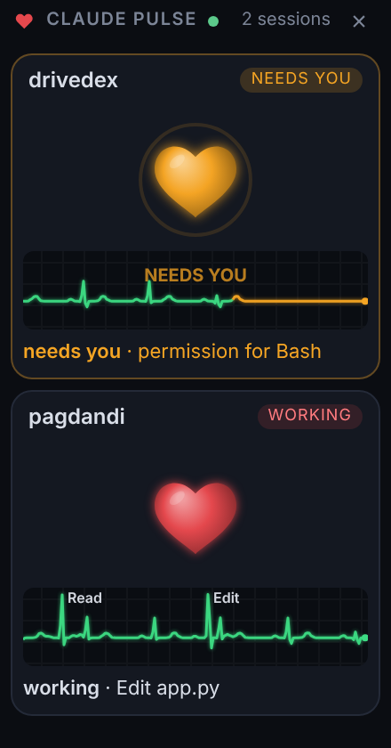
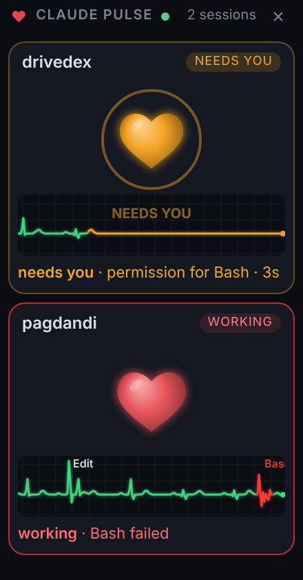
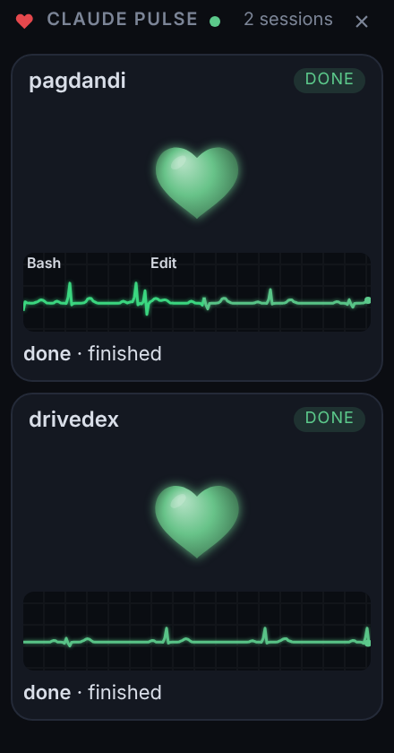

# Claude Pulse

[](https://github.com/YashwardhanV/claude-pulse/actions/workflows/tests.yml)


[](LICENSE)

**A live heartbeat monitor for [Claude Code](https://code.claude.com).** A small always-on-top
window at the edge of your screen tells you, at a glance, the only three things that matter about
each Claude Code session: **working**, **needs you**, or **done**. You stop switching back to the
terminal to check on it.

* **One card per session**, with a beating heart and a scrolling ECG strip. Every tool call is a
  labelled spike; a failed tool is a red spike.
* **Needs you** turns the card amber, moves it to the top and says why (permission for Bash, a
  question for you, plan approval).
* **Phone notifications** through ntfy when a session has been waiting on you for a while, or has
  finished a long task.
* **Context usage in Claude Code's own status line**, using Claude Code's real numbers.
* **Out of your way:** the window only exists while a session is live, × mutes it for those
  sessions, and `pulse.py off` turns everything off.
* **Costs Claude almost nothing:** per-tool hooks run async, so Claude never waits for Pulse.

```
Claude Code --hook (stdin JSON)--> curl (async for tool events, 0.3 s connect timeout, always exit 0)
                                       | POST http://127.0.0.1:7777/event
                                       v
                        pulse server (one Python process)
            |- session registry + state machine (per session_id)
            |- ntfy notifier
            '- SSE /stream --> pywebview window (web/index.html, canvas)

Claude Code --status line JSON--> python pulse.py statusline --> "pagdandi · Opus · ctx ▓▓▓▓░░░░░░ 42%"
```

<p align="center">
  
  
  
</p>
<p align="center"><sub>Needs you + working &nbsp;·&nbsp; a failed tool &nbsp;·&nbsp; done (all from <code>python pulse.py demo</code>)</sub></p>

## Quick start

```powershell
git clone https://github.com/YashwardhanV/claude-pulse.git
cd claude-pulse
python pulse.py demo        # see every state with two fake sessions; no Claude needed
python pulse.py install     # merge hooks + status line into ~/.claude/settings.json (backup first)
# restart Claude Code: the window appears on its own at the next session start
```

Requirements: Python 3.11+, `curl` (built into Windows 10/11 and macOS), and `pywebview`
(`install` runs pip for you). Per platform:

* **Windows 10/11:** the Edge WebView2 runtime (included with Windows 11). Main platform; hover
  fade is Windows-only.
* **macOS:** works with plain `pip install pywebview` (uses WebKit).
* **Linux:** pywebview needs a GUI backend: `pip install "pywebview[qt]"` or the GTK packages. Without
  one, Pulse runs headless and you can open `http://127.0.0.1:7777/` in a browser.

`pytest` is only needed to run the tests.

## The three states

| Card | When | Heart | ECG |
|---|---|---|---|
| **working** | Prompt sent, or a tool finished | Red, ~75 bpm, an extra pulse for each tool call | A tall labelled spike per tool call (`Edit`, `Bash`, …) |
| **needs you** | Permission dialog, a question from Claude (`AskUserQuestion`, plan approval), or input requested | **Amber**, beat-beat-pause, a pulsing ring; the card moves to the top | Amber flat line with **NEEDS YOU** |
| **done** | `Stop`: Claude finished its turn. A brand-new session shows the same calm heart, badged **ready** | Green, slow and calm | Slow, even rhythm |

When a session ends (`SessionEnd`, or 15 minutes with no events) its card fades out.

Not states, just marks on the strip:

* **A tool failed** (`PostToolUseFailure`, or an error in `tool_response`): a jagged red spike, a
  white flash, a red card border for a few seconds, and the status line says `Bash failed`.
* **Subagent finished** (`SubagentStop`): a small three-beat flutter.
* **Compaction** (`PreCompact`): one "deep breath": the heart shrinks, then expands.

Using the window:

* The line under the ECG shows the state and the last action, e.g. `working · Edit app.py` or
  `needs you · permission for Bash · 42s`.
* **Click a card** to see its last 15 events with timestamps. Click again to collapse it.
* **Drag** the window by the top bar or a card header. The position is remembered.
* **Hover** over the window to make it see-through (Windows).
* **×** mutes every session that is live right now: their events no longer bring the window back,
  for as long as those sessions run. A *new* session shows it again. The server keeps running, and
  phone notifications still arrive.
* With **more than 4 sessions** the cards switch to compact mode: small hearts, no ECG.

## Context usage: in the status line

`install` adds a [status line](https://code.claude.com/docs/en/statusline) to Claude Code, unless
you already have one (then yours is left alone):

```
pagdandi · Opus 5.5 · ctx ▓▓▓▓░░░░░░ 42%
drivedex · ctx ▓▓▓▓▓▓▓▓▓░ 93% of 1M · consider /compact
```

Green under 50%, yellow to 75%, orange to 90%, red above. It reads `context_window.used_percentage`
and `context_window_size` straight from Claude Code, so 1M-context models are right from the first
message, and nothing has to tail transcript files. Before the first reply, and right after
`/compact`, it shows `ctx —`.

To use it with your own status line, call `python /path/to/claude-pulse/pulse.py statusline` from
your script with the same stdin, or skip it with `install --no-statusline`.

## Commands

| Command | What it does |
|---|---|
| `python pulse.py demo [--ntfy] [--speed 2] [--seconds N]` | Two fake sessions (`pagdandi`, `drivedex`) go through every state in about 60 s, on a random port, without touching your real server. `--ntfy` also sends the two notifications, with shortened thresholds. |
| `python pulse.py install [--no-pip] [--no-statusline]` | Backs up `~/.claude/settings.json` to `settings.json.bak-<timestamp>`, merges in the hooks and the status line, and pip-installs `pywebview`. It is idempotent and never removes or changes your other settings or hooks. |
| `python pulse.py uninstall` | Removes only Claude Pulse's hooks and status line (with a backup). |
| `python pulse.py off` | Switches Pulse off completely: removes the hooks and status line (so nothing can relaunch it) and stops the server. Config is kept. |
| `python pulse.py on` | Puts the hooks and status line back (no pip). The window appears at the next session start. |
| `python pulse.py stop` | Stops the background server (the next session start brings it back). |
| `python pulse.py status` | Shows whether the server is running, how many hooks are installed, and where the config and log are. |
| `python pulse.py ntfy-test` | Sends a test phone notification and prints how to subscribe. |
| `python pulse.py statusline` | The status line command. Reads Claude Code's status line JSON on stdin. |
| `python pulse.py serve [--headless]` | Runs the server and window in the foreground. You don't normally need this. |
| `python pulse.py ensure-running` | What the `SessionStart` hook runs. It starts the server if needed and forwards the hook payload. |

After `install`, **restart Claude Code** (hooks are read at session start), then check with
`/hooks`. What it adds:

| Event | Matcher | Runs | Why |
|---|---|---|---|
| `SessionStart` | `*` | sync: `python pulse.py ensure-running` | Starts the server if it isn't up |
| `PostToolUse`, `PostToolUseFailure` | `*` | **async** curl | The tool spikes. Claude does not wait for these |
| `SubagentStop`, `PreCompact` | `*` | **async** curl | Flutter and breath |
| `PreToolUse` | `AskUserQuestion\|ExitPlanMode` | sync curl | Only the tools that are a question to you |
| `UserPromptSubmit`, `PermissionRequest`, `Notification`, `Stop`, `SessionEnd` | | sync curl | About once per turn; kept in order so "done" and "needs you" are never overtaken |
| `statusLine` | | `python pulse.py statusline` | Context usage |

The curl command is
`curl.exe -s -m 1 --connect-timeout 0.3 -o NUL -H "Content-Type: application/json" --data-binary "@-" http://127.0.0.1:7777/event ; exit 0 # claude-pulse`
on Windows (it parses the same in Git Bash and PowerShell), and `curl … -o /dev/null …` elsewhere.
It always exits 0 and prints nothing. The trailing `# claude-pulse` comment is how install and
uninstall recognise their own entries. Details are in [docs/HOOKS_NOTES.md](docs/HOOKS_NOTES.md).

## Auto-start

The `SessionStart` hook runs `pulse.py ensure-running`, which:

1. Probes `127.0.0.1:<port>` once. If Claude Pulse is up, it forwards the hook payload and exits.
2. If `autostart` is `false` in the config, it stops there.
3. Otherwise it saves the payload to `~/.claude-pulse/spool/` (the server replays it on startup,
   so the first session isn't missed), takes `~/.claude-pulse/starting.lock` so two terminals
   starting at once don't launch two servers, and starts `pulse.py serve` fully detached (on
   Windows with `pythonw` and `DETACHED_PROCESS | CREATE_NEW_PROCESS_GROUP |
   CREATE_BREAKAWAY_FROM_JOB`). The server outlives the terminal.
4. It exits 0 in about 0.5 s and swallows every error.

The listening port is the real single-instance lock. `~/.claude-pulse/pulse.pid` records the PID.
Closing the window for real (Alt+F4) stops the server, and the next session start brings it back.
To stop that, use `python pulse.py off` or set `"autostart": false`.

## Phone notifications (ntfy)

1. Run `python pulse.py ntfy-test`. It prints your topic, a random 24-character string that was
   generated on first run.
2. Install the **ntfy** app (Android: Play Store or F-Droid; iPhone: App Store), tap **+** and
   subscribe to that topic on `ntfy.sh`.
3. Set `"ntfy": {"enabled": true, ...}` in `~/.claude-pulse/config.json`, then restart the
   server (`python pulse.py stop`; it comes back on the next session start).

You get:

* **Claude needs you — <project>** (high priority), but only if the session is *still* waiting
  after `notify_blocked_after_seconds`. If you answer quickly, nothing is sent.
* **Claude finished — <project>** (default priority) on `Stop`, but only if the task ran longer
  than `notify_done_if_session_ran_minutes`.

There is at most one notification per session per state change. **Privacy:** anyone who knows an
ntfy topic can read it, so notifications contain only the project folder name and the event type.
They never include code, file names, prompts or commands. Keep your topic secret, or point
`ntfy.server` at your own ntfy instance.

## Config: `~/.claude-pulse/config.json`

Created on first run:

| Key | Default | Meaning |
|---|---|---|
| `autostart` | `true` | `false`: hooks never launch the server. Start it yourself with `python pulse.py serve` when you want it. |
| `port` | `7777` | Local port, bound to 127.0.0.1 only. If you change it, re-run `install` so the hooks use the new port. |
| `ntfy.enabled` | `false` | Send phone notifications. |
| `ntfy.server` | `https://ntfy.sh` | ntfy server. |
| `ntfy.topic` | random | Your private topic name. |
| `notify_blocked_after_seconds` | `30` | How long a session must wait on you before your phone buzzes. |
| `notify_done_if_session_ran_minutes` | `2` | Only notify "finished" for tasks longer than this. |
| `window.x`, `window.y` | `null` | Window position. `null` docks it to the right edge of the primary monitor. Saved when you drag. |
| `window.opacity` | `0.95` | Window opacity. Hovering drops it to 0.35. |

Config changes take effect when the server restarts (`python pulse.py stop`). Keys from older
versions (`thinking_silence_seconds`, `context_window_*`) are ignored.

## Troubleshooting

* **Port in use.** `pulse.py status` says "not running", but `serve` logs `cannot listen on
  127.0.0.1:7777`. Another program owns the port. Set a different `port` in the config and re-run
  `python pulse.py install` so the hooks point at it.
* **The window doesn't show.**
  * Check `python pulse.py status` and the log at `~/.claude-pulse/pulse.log`.
  * Try `python pulse.py serve` in a terminal to see errors. If pywebview can't start, it falls
    back to headless mode, and you can open `http://127.0.0.1:7777/` in a browser.
  * pywebview on Windows needs the WebView2 runtime; on Linux it needs Qt or GTK (see Quick start).
  * If you pressed ×, those sessions are muted; the window comes back with the next new session.
  * If the window ended up off-screen, set `window.x`/`window.y` to `null` in the config.
* **Hooks not firing.** Restart Claude Code, because hooks load at session start. Then run `/hooks`
  inside Claude Code and look for the `# claude-pulse` entries, and run `python pulse.py status`.
  To test the pipe by hand from Git Bash or a Unix shell:
  `echo '{"hook_event_name":"UserPromptSubmit","session_id":"t1","cwd":"C:/x/test"}' | curl -s -m 1 --data-binary "@-" http://127.0.0.1:7777/event`
  and a `test` card should appear.
* **No context in the status line.** You already had a status line, so `install` left it alone
  (it says so). Point your status line at `pulse.py statusline`, or keep yours.
* **It keeps coming back and I want a break:** `python pulse.py off` (undo with `on`), or set
  `"autostart": false` to keep the hooks but only run Pulse when you start it.
* **Uninstall everything:** `python pulse.py off`, then delete `~/.claude-pulse/`.

## Known limitations and design decisions

* **Three states, on purpose.** Earlier versions also showed `thinking` (guessed from 5 s of
  silence) and an `error` state. Neither changed what you do next, so they are gone: silence is
  still `working`, and a failure is a red spike.
* **Async tool hooks can arrive late.** A `PostToolUse` can land just after the synchronous `Stop`
  or `PermissionRequest` that followed it. For 3 s after a session becomes done or needs-you, a
  tool result is drawn on the strip but doesn't change the state, unless it is the very call you
  just approved or answered (matched by tool name and summary, since `PermissionRequest` has no
  `tool_use_id`).
* **No "working" while a long tool runs after approval.** The card stays amber until the approved
  tool finishes, because no hook fires when you click Allow.
* **Why not HTTP hooks?** Claude Code can POST hook JSON straight to a URL with no shell at all
  (`"type": "http"`), but when Pulse isn't running each one shows a `hook error` notice in your
  transcript. Async command hooks cost Claude no waiting and stay silent.
* **`idle_prompt` notifications** (Claude idle at the prompt about 60 s after finishing) don't turn
  a `done` session amber, because the "finished" notification already covers it. They do count as
  needs-you if no `Stop` was seen.
* **Esc / interrupt.** A tool failure with `is_interrupt` marks the session `done · interrupted`,
  because `Stop` may not fire after an interrupt. An interrupt with no tool running fires no hook,
  so that card stays `working` until the next event.
* **Sessions waiting on you are kept for 60 min** instead of 15 before being treated as stale.
* **Privacy.** The server reads the hook JSON in memory and keeps only the tool name, a file
  basename, or the first 40 characters of a shell command. These are shown in the local window
  only. Prompts, messages, file contents and tool output are never stored, logged or forwarded.
  The log records only event names and short session ids.
* **Primary monitor only** for the default dock position. Drag the window anywhere afterwards.
* The window is fixed at 220 px wide and up to 4 full cards tall. Beyond 4 sessions it switches
  to compact mode.
* Frame rate is capped at 30 fps and drops to 5 fps when every session is done or ended.

## Layout

```
pulse.py              CLI entry point
pulse/state.py        state machine + registry (pure, unit-tested)
pulse/summarize.py    content-free summaries of tool calls
pulse/statusline.py   context usage for Claude Code's status line
pulse/server.py       HTTP intake, SSE hub, timers
pulse/notifier.py     ntfy
pulse/window.py       pywebview window (dock, drag-save, hide/mute, hover fade)
pulse/launcher.py     ensure-running, detached spawn, spool, locks
pulse/installer.py    settings.json merge/strip
pulse/demo.py         demo script
web/index.html        canvas heart + ECG + cards (no frameworks)
docs/HOOKS_NOTES.md   what was verified against the official docs
docs/screenshots/     README images
tests/                pytest suite (state machine, mute, status line, notifier, installer, real hook commands)
```

Run the tests with `python -m pytest -q`. CI runs them on Windows, macOS and Linux with Python
3.11–3.13.

## License

[MIT](LICENSE)
