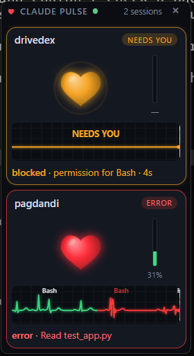
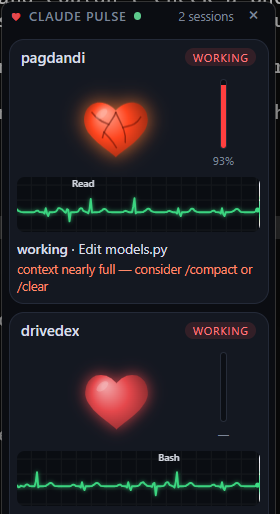
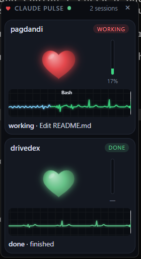

# Claude Pulse

[](https://github.com/YashwardhanV/claude-pulse/actions/workflows/tests.yml)


[](LICENSE)

**A live heartbeat monitor for [Claude Code](https://code.claude.com).** A small always-on-top window on the right edge of your screen that shows what Claude Code is
doing, so you don't have to switch back to the terminal to check on it. The window only
appears while a Claude Code session is live and hides itself when the last one ends, so it never
sits over your other apps when you're not using Claude Code.

* **A beating heart and a scrolling ECG strip.** The heart's rhythm follows Claude Code's state.
  Every tool call adds a taller spike labelled with the tool name.
* **One card per Claude Code session.** Run Claude in three terminals and you get three hearts.
* **Phone notifications** through ntfy.sh when a session has been waiting on you for a while, or
  has finished a long task.
* **"Blood pressure" shows context-window usage.** The heart strains as the context fills up.

```
Claude Code --hook (stdin JSON)--> curl.exe (0.3s connect timeout, always exit 0)
                                       | POST http://127.0.0.1:7777/event
                                       v
                        pulse server (one Python process)
            |- session registry + state machine (per session_id)
            |- transcript watcher (tails transcript_path JSONL)
            |- ntfy notifier
            '- SSE /stream --> pywebview window (web/index.html, canvas)
```

<p align="center">
  
  
  
</p>
<p align="center"><sub>Blocked + error &nbsp;·&nbsp; context nearly full &nbsp;·&nbsp; working + done (all from <code>python pulse.py demo</code>)</sub></p>

## Quick start

```powershell
git clone https://github.com/YashwardhanV/claude-pulse.git
cd claude-pulse
python pulse.py demo        # see every state with two fake sessions; no Claude needed
python pulse.py install     # merge the hooks into ~/.claude/settings.json (backup first)
# restart Claude Code: the window appears on its own at the next session start
```

Requirements: Windows 10/11, Python 3.11+ (built and tested on 3.13), the Edge WebView2 runtime
(included with Windows 11), and `pywebview` (`install` runs pip for you). `pytest` is only
needed to run the tests.

## What the heart means

| State | When | Heart | ECG |
|---|---|---|---|
| `idle` | Session started, no prompt yet | Very slow (~40 bpm), dim | Flat with tiny bumps |
| `working` | Prompt sent, or any tool event | Normal (~75 bpm), an extra pulse for each tool call | A tall labelled spike per tool call (`Edit`, `Bash`, …) |
| `thinking` | No tool events for 5 s while a task is running, or the transcript shows a fresh thinking block | Fast (~130 bpm), slightly brighter | Rapid small cyan waves |
| `blocked` | Permission dialog, a question from Claude (`AskUserQuestion`, plan approval), or input requested | **Amber**, beat-beat-pause, a pulsing ring; the card moves to the top and its border pulses | Amber flat line with **NEEDS YOU** |
| `error` | A tool failed (`PostToolUseFailure`, or an error in `tool_response`) | Irregular, arrhythmic beat and red flashes for 6 s, then back to the underlying state | Jagged red spike |
| `done` | `Stop`: Claude finished its turn | Slow and calm (~50 bpm), green | Slow, even rhythm |
| `ended` | `SessionEnd`, or no events for 15 min | Fades out; the card is removed after 10 s | — |

Extras:

* **Subagent finished** (`SubagentStop`): a small three-beat flutter.
* **Compaction** (`PreCompact`): one "deep breath" (the heart shrinks, then expands), and the
  pressure gauge resets until the next reading.
* **Blood pressure** is the thin bar next to the heart, with a percentage:
  * under 50%: normal
  * 50–75%: the heart color deepens
  * 75–90%: veins appear and the heart trembles on each beat
  * over 90%: the heart glows red-hot, with the hint *context nearly full — consider /compact or /clear*
* The line under the ECG shows the state and the last action, e.g. `working · Edit app.py` or
  `blocked · permission for Bash · 42s`.
* **Click a card** to see its last 15 events with timestamps. Click again to collapse it.
* **Drag** the window by the top bar or a card header. The position is remembered.
* **Hover** over the window to make it see-through.
* **×** hides the window. It comes back on the next hook event, and the server keeps running.
* With **more than 4 sessions** the cards switch to compact mode: small hearts, no ECG.

## Commands

| Command | What it does |
|---|---|
| `python pulse.py demo [--ntfy] [--speed 2] [--seconds N]` | Two fake sessions (`pagdandi`, `drivedex`) cycle through every state in about 60 s, on a random port, without touching your real server. `--ntfy` also sends the two notifications, with shortened thresholds. |
| `python pulse.py install [--no-pip]` | Backs up `~/.claude/settings.json` to `settings.json.bak-<timestamp>`, merges in the hooks, and pip-installs `pywebview`. It is idempotent and never removes or changes your other settings or hooks. |
| `python pulse.py uninstall` | Removes only Claude Pulse's hooks (with a backup). |
| `python pulse.py ntfy-test` | Sends a test phone notification and prints how to subscribe. |
| `python pulse.py status` | Shows whether the server is running, how many hooks are installed, and where the config and log are. |
| `python pulse.py stop` | Stops the background server. |
| `python pulse.py serve [--headless]` | Runs the server and window in the foreground. You don't normally need this. |
| `python pulse.py ensure-running` | What the `SessionStart` hook runs. It starts the server if needed and forwards the hook payload. |

After `install`, **restart Claude Code** (hooks are read at session start), then check with
`/hooks`. The hooks it adds:

```
SessionStart  -> python pulse.py ensure-running ; exit 0 # claude-pulse
everything else (UserPromptSubmit, PreToolUse, PostToolUse, PostToolUseFailure,
PermissionRequest, Notification, Stop, SubagentStop, PreCompact, SessionEnd) ->
curl.exe -s -m 1 --connect-timeout 0.3 -o NUL -H "Content-Type: application/json" --data-binary "@-" http://127.0.0.1:7777/event ; exit 0 # claude-pulse
```

The same command parses correctly in Git Bash, which Claude Code uses on Windows when Git is
installed, and in PowerShell. It always exits 0 and prints nothing. Measured on this machine: about 0.13 s per
hook with the server up and about 0.4 s with it down, most of which is the shell starting. The trailing
`# claude-pulse` comment is how install and uninstall recognise their own entries. Details are
in [docs/HOOKS_NOTES.md](docs/HOOKS_NOTES.md).

## Auto-start

The `SessionStart` hook runs `pulse.py ensure-running`, which:

1. Probes `127.0.0.1:<port>` once. If Claude Pulse is up, it forwards the hook payload and exits.
2. Otherwise it saves the payload to `~/.claude-pulse/spool/` (the server replays it on startup,
   so the first session isn't missed), takes `~/.claude-pulse/starting.lock` so two terminals
   starting at once don't launch two servers, and starts `pythonw pulse.py serve` with
   `DETACHED_PROCESS | CREATE_NEW_PROCESS_GROUP | CREATE_BREAKAWAY_FROM_JOB`. The server outlives
   the terminal.
3. It exits 0 in about 0.5 s and swallows every error.

The listening port is the real single-instance lock. `~/.claude-pulse/pulse.pid` records the PID.
Closing the window for real (Alt+F4) stops the server, and the next session start brings it back.

## Phone notifications (ntfy)

1. Run `python pulse.py ntfy-test`. It prints your topic, a random 24-character string that was
   generated on first run.
2. Install the **ntfy** app (Android: Play Store or F-Droid; iPhone: App Store), tap **+** and
   subscribe to that topic on `ntfy.sh`.
3. Set `"ntfy": {"enabled": true, ...}` in `~/.claude-pulse/config.json`, then restart the
   server (`python pulse.py stop`; it comes back on the next session start).

You get:

* **Claude needs you — <project>** (high priority), but only if the session is *still* blocked
  after `notify_blocked_after_seconds`. If you answer quickly, nothing is sent.
* **Claude finished — <project>** (default priority) on `Stop`, but only if the task ran longer
  than `notify_done_if_session_ran_minutes`.

There is at most one notification per session per state change. **Privacy:** anyone who knows an
ntfy topic can read it, so notifications contain only the project folder name and the event type.
They never include code, file names, prompts or commands. Keep your topic secret, or point
`ntfy.server` at your own ntfy instance.

## Config: `~/.claude-pulse/config.json`

Created on first run:

| Key | Default | Meaning |
|---|---|---|
| `port` | `7777` | Local port, bound to 127.0.0.1 only. If you change it, re-run `install` so the hooks use the new port. |
| `ntfy.enabled` | `false` | Send phone notifications. |
| `ntfy.server` | `https://ntfy.sh` | ntfy server. |
| `ntfy.topic` | random | Your private topic name. |
| `notify_blocked_after_seconds` | `30` | How long a session must stay blocked before your phone buzzes. |
| `notify_done_if_session_ran_minutes` | `2` | Only notify "finished" for tasks longer than this. |
| `thinking_silence_seconds` | `5` | Silence after a prompt or tool event before the state becomes `thinking`. |
| `context_window_tokens` | `200000` | Default context window for the pressure gauge. |
| `context_window_overrides` | `{}` | Per-model windows, e.g. `{"claude-opus-5-5": 1000000}`. Filled in automatically (see below). |
| `window.x`, `window.y` | `null` | Window position. `null` docks it to the right edge of the primary monitor. Saved when you drag. |
| `window.opacity` | `0.95` | Window opacity. Hovering drops it to 0.35. |

Config changes take effect when the server restarts (`python pulse.py stop`).

## Troubleshooting

* **Port in use.** `pulse.py status` says "not running", but `serve` logs `cannot listen on
  127.0.0.1:7777`. Another program owns the port. Set a different `port` in the config and re-run
  `python pulse.py install` so the hooks point at it.
* **The window doesn't show.**
  * Check `python pulse.py status` and the log at `~/.claude-pulse/pulse.log`.
  * Try `python pulse.py serve` in a terminal to see errors. If pywebview can't start, it falls
    back to headless mode, and you can open `http://127.0.0.1:7777/` in a browser.
  * pywebview on Windows needs the WebView2 runtime.
  * If you pressed ×, the window comes back on the next Claude event.
  * If the window ended up off-screen, set `window.x`/`window.y` to `null` in the config.
* **Hooks not firing.** Restart Claude Code, because hooks load at session start. Then run `/hooks`
  inside Claude Code and look for the `# claude-pulse` entries, and run `python pulse.py status`.
  To test the pipe by hand from Git Bash:
  `echo '{"hook_event_name":"UserPromptSubmit","session_id":"t1","cwd":"C:/x/test"}' | curl.exe -s -m 1 --data-binary "@-" http://127.0.0.1:7777/event`
  and a `test` card should appear.
* **Pressure looks wrong.** See "Context window size" under known limitations. Set
  `context_window_overrides` for your model.
* **Uninstall everything:** `python pulse.py uninstall`, `python pulse.py stop`, then delete
  `~/.claude-pulse/`.

## Known limitations and design decisions

* **Thinking is inferred.** Hooks don't fire while the model is reasoning, so the main signal is
  silence: 5 s with no tool events while a task is running. The transcript watcher confirms it
  early when the newest main-chain transcript line is a thinking block. Transcript entries may
  only be written when a content block completes, not while it streams, so the silence
  heuristic stays the main signal.
* **Context window size.** The transcript doesn't record the window size. Pulse uses
  `context_window_tokens` (200k by default). The moment a session's usage goes over that, it knows
  the model has a 1M window: it switches to 1,000,000 and **remembers that per model** in
  `context_window_overrides`. A `[1m]` model id at `SessionStart` also selects 1M. Until a model has
  crossed 200k once, a 1M-context session reads 5× too high. Pre-set the override if you know your
  model's window. The percentage uses the status line's formula: input + cache read + cache
  creation tokens of the latest main-chain assistant message, ignoring subagents.
* **After `/compact`** the gauge shows `—` until the next assistant message is written.
* **`idle_prompt` notifications** (Claude idle at the prompt about 60 s after finishing) don't
  turn a `done` session amber, because the "finished" notification already covers it. They do
  count as blocked if no `Stop` was seen.
* **Esc / interrupt.** A tool failure with `is_interrupt` marks the session `done ·
  interrupted`, because `Stop` may not fire after an interrupt. An interrupt during pure thinking
  fires no hook, so that card stays `thinking` until the next event.
* **Blocked sessions are kept for 60 min** instead of 15 before being treated as stale. That's
  exactly when you most want to see them.
* **Privacy.** The server reads the hook JSON in memory and keeps only the tool name, a file
  basename, or the first 40 characters of a shell command. These are shown in the local window
  only. Prompts, messages, file contents and tool output are never stored, logged or forwarded.
  The log records only event names and short session ids.
* **Hook cost.** Each hook spawns a shell (about 0.1 s in Git Bash), so a tool call costs about
  0.25 s of hook time for Pre and Post. Claude Code supports `"async": true` on command hooks to
  hide this, but async hooks can arrive out of order, so Pulse uses synchronous hooks.
* **Primary monitor only** for the default dock position. Drag the window anywhere afterwards.
* The window is fixed at 220 px wide and up to 4 full cards tall. Beyond 4 sessions it switches
  to compact mode.
* Frame rate is capped at 30 fps and drops to 5 fps when every session is idle, done or ended.

## Layout

```
pulse.py              CLI entry point
pulse/state.py        state machine + registry (pure, unit-tested)
pulse/summarize.py    content-free summaries of tool calls
pulse/server.py       HTTP intake, SSE hub, timers
pulse/transcript.py   JSONL tailer: thinking confirmation + context usage
pulse/notifier.py     ntfy
pulse/window.py       pywebview window (dock, drag-save, hide/show, hover fade)
pulse/launcher.py     ensure-running, detached spawn, spool, locks
pulse/installer.py    settings.json merge/strip
pulse/demo.py         demo script
web/index.html        canvas heart + ECG + cards (no frameworks)
docs/HOOKS_NOTES.md   what was verified against the official docs
docs/screenshots/     README images
tests/                pytest suite (state machine, transcript, notifier, installer, real hook commands)
```

Run the tests with `python -m pytest -q`. CI runs them on Windows with Python 3.11–3.13.

## License

[MIT](LICENSE)
